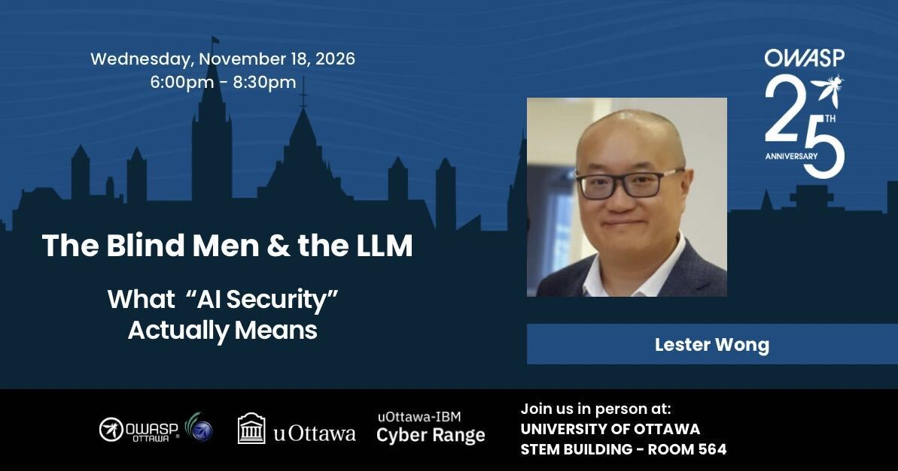

## Next Meeting/Event(s)

## Wednesday November 18th, 2026
### Details

Welcome to our in-Person Meetup at the University of Ottawa

In-Person Location:
***150 Louis-Pasteur Private, Ottawa,
University of Ottawa
Room 564***

We will continue to Live Stream on our YouTube channel. (https://www.youtube.com/@OWASP_Ottawa). Subscribe to our YouTube channel, set a reminder and you’ll get a notification as soon as we go live!

YouTube Live Stream Link: TBA

***6:00 PM EST*** Arrival, setup, mingle, PIZZA!!!

***6:45PM EST*** Technical Talks
* Introduction to OWASP Ottawa, Public Announcements.
* ***The Blind Men & the LLM: What “AI Security” Actually Means*** with Lester Wong

### Abstracts:

***The Blind Men & the LLM: What “AI Security” Actually Means with Lester Wong***

Ask five security people what "AI Security" means and you'll get five different answers — data leakage, model attacks, or something else entirely. This talk cuts through the confusion with a story-driven tour of the field, using real headline incidents including a chatbot that agreed to sell a $76,000 SUV for $1 and a company held liable for its own bot's made-up refund policy — to explain the real risks facing organizations adopting AI today, and practical steps to manage them. The takeaway: AI security isn't a brand-new discipline — it's your existing security practices, applied to a new and unfamiliar attack surface.

### Speaker:
***Lester Wong*** is an advisor on Cyber, AI and IT Modernization.  He currently co-chairs the Ottawa chapter of the AI Security Engineers community.  A Cisco veteran of more than two decades, Lester led sales and strategy for software, hardware and SaaS, working with governments and enterprise customers across Canada. Lester holds a BASc in Computer Engineering from the University of Ottawa. In his current role, Lester helps organizations navigate the security implications of AI adoption at the intersection of enterprise infrastructure, application development, IT, and emerging technologies.
